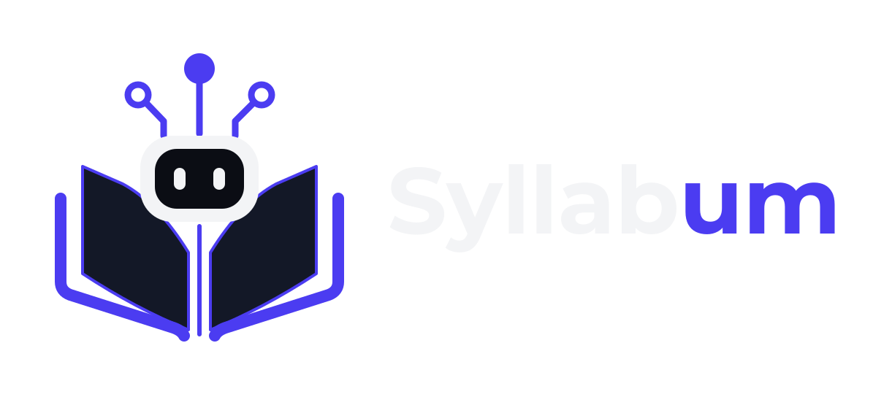

# Syllabum



> Um tutor educional inteligente para orientar o aprendizado e aprofundamento de competências técnicas.

O Syllabum é um projeto de desenvolvimento de software que busca explorar o uso da Inteligência Artificial para proporcionais uma experiência de aprendizagem orientada a objetivos, conhecimentos e dificuldades individuais de cada estudante.

## Sobre o Projeto:

A diversidade de tecnologias, ferramentas e áreas de atuação em TI costumam ser um dificultador na organização dos estudos, especialmente para quem está iniciando a trajetório ou deseja desenvolver novas competências na área da tecnologia.

Nesse contexto, o Syllabum se descreve como uma plataforma educacional que usa mecanismos de Inteligência Artificial Generativa para desenvolver um tutor capaz de auxiliar o estudante e estruturar sua aprendizagem, desenvolver conhecimentos e resolver problemas técnicos.

O projeto tem como objetivo inicial desenvolver um MVP (Produto Mínimo Viável) que permita implementar e avaliar as principais funcionalidades da plataforma.

## Funcionalidades Planejadas:

- **Estruturação de Cursos com IA Generativa**: geração de propostas de cursos alinhadas aos objetivos de aprendizagem informados pelo estudante;
- **Cadastro e Gerenciamento de Cursos**: registro e recuperação da estrutura dos cursos geradas pela IA;
- **Modo Tutor**: interação voltada à análise e compreensão de conceitos, explicações didáticas e desenvolvimento de conhecimentos;
- **Modo Debugger**: interação voltada para a análise de problemas técnicos, como erros de execução e em trechos de código;
- **Identificação contextual de interação**: comportamento da IA direcionado à intenção predominante com o estudante;
- **Aprendizagem Orientada a Projetos**: utiização de atividades práticas para desenvolver e consolidar competências técnicas, conforme necessidades percebidas pela IA;

As funcionalidades acima representam a direção planejada para o produto. Sua inclusão definitiva no MVP dependerá da definição e priorização do escopo.

## Status do Projeto:

- **Etapa Atual**: Documentação e Planejamento do MVP.

O desenvolvimento será conduzido de forma incremental, utilizando práticas ágeis para organizar as tarefas, acompanhar o progresso e validar as funcionalidades implementadas.

## Documentação:

```

./
├── backend/               #  Diz respeito ao código-fonte da API, conexões, etc.
|
├── frontend/              #  Diz respeito aos componentes e UX do Syllabum.
|
├── docs/                  #  Diz respeito à documentação do Syllabum como projeto e como produto.
|
├── LICENSE                #  Licença (Apache-2.0)
|
└── README.md              #  O que você está lendo agora. Documentação geral.

```

Para ver cada um dos documentos minunciosamente:

- [Acessar Repositório do Frontend](./backend)
- [Acessar Repositório do Backend](./frontend)
- [Acessar Documentação do Projeto](./docs)

## Tecnologias:

<table align="center">
<tr><th align="center">Categoria</th><th align="center">Tecnologias</th></tr>
<tr>
<td align="center"><b>Frontend</b></td>
<td align="center">


</td>
</tr>
<tr>
<td align="center"><b>Backend</b></td>
<td align="center">


</td>
</tr>
<tr>
<td align="center"><b>Banco de Dados</b></td>
<td align="center">

</td>
</tr>
<tr>
<td align="center"><b>Inteligência Artificial</b></td>
<td align="center">


</td>
</tr>
<tr>
<td align="center"><b>Ferramenta de Testes</b></td>
<td align="center">

</td>
</tr>
</table>
