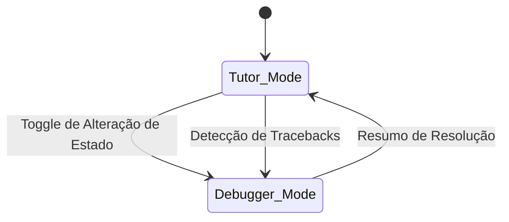

# Fluxo do Tutor:

- **Versão**: 0.1
- **Produto**: Syllabum - Tutor Educacional Inteligente
- **Data de Publicação**: 25/10/2026
- **Última Atualização**: 25/10/2026

## Visão Geral do Diagrama de Estados:

## Modo Tutor:

- **Propósito**: conduzir o aprendizado de um conceito dentro do projeto do usuário, em abordagem socrática.

| ID   | Regra                                                                                                                                                   |
| ---- | ------------------------------------------------------------------------------------------------------------------------------------------------------- |
| T-01 | O Tutor parte do objetivo e do plano de estudos do usuário e propõe o próximo conceito a trabalhar.                                                     |
| T-02 | Prioriza perguntas que levem o usuário a raciocinar, podendo exibir trechos de código de exemplo, desde que não resolvam o problema do próprio projeto. |
| T-03 | Um conceito é considerado concluído quando o usuário o aplica corretamente em um exercício.                                                             |
| T-04 | Ao detectar erro de execução ou pedido de ajuda com código, sugere abrir o Debugger.                                                                    |
| T-05 | Não gera o código completo da funcionalidade do usuário.                                                                                                |

**Entrada**: Início de sessão.
**Saída**: Conceito concluído ou contexto para o Debugger.

## Modo Debugger:

**Propósito**: Ajudar o usuário a localizar e corrigir problemas específicos em depurações, guiando-o por perguntas e escalando a ajuda de forma controlada. É sempre uma bifurcação especializada em depuração de um Workspace Tutor.

### Escalonamento de Ajuda:

| Degrau | Tipo de Ajuda                                  | Sobe de degrau quando                           |
| ------ | ---------------------------------------------- | ----------------------------------------------- |
| 1      | Pergunta aberta que redireciona a atenção      | 2 respostas sem progresso.                      |
| 2      | Dica que aponta a região ou o conceito         | Mesmo erro após a dica, ou 2 tentativas falhas. |
| 3      | Exemplo análogo resolvido (problema diferente) | 2 tentativas                                    |
| 4      | Resolução comentada                            | ---                                             |

| ID   | Regra                                                                                                                                |
| ---- | ------------------------------------------------------------------------------------------------------------------------------------ |
| D-01 | Começa sempre no degrau 1, impedindo que degraus sejam pulados.                                                                      |
| D-02 | Se o usuário pedir a resposta direta, exceto quando já estiver no degrau 4, a resposta será ponderada e moderada pelo degrau atual.  |
| D-03 | O Debugger registra o conceito que parece faltar ao usuário.                                                                         |
| D-04 | O Debugger só é devidamente encerrado quando o problema do usuário é dado como resolvido, com confirmação apenas do próprio usuário. |

## Gatilhos para Alteração de Estado:

| ID   | De -> Para        | Gatilho                                                                                                                             | Tipo                  |
| ---- | ----------------- | ----------------------------------------------------------------------------------------------------------------------------------- | --------------------- |
| G-01 | Tutor -> Debugger | O usuário aciona toggle de Depuração                                                                                                | Explícito             |
| G-02 | Tutor -> Debugger | O usuário cola tracebacks, erros, códigos com bugs                                                                                  | Implícito             |
| G-03 | Debugger -> Tutor | Resolução e resumo do Problema, com informação de até qual degrau o usuário chegou com o Modo Debugger até resolver o seu problema. | Agregação de contexto |
| G-04 | Debugger -> Tutor | O usuário encerra o Modo Debugger manualmente                                                                                       | Explícito             |

Nenhuma transição entre os modos é feita sem ação do usuário, implícita ou explicitamente.

## Resoluções do Modo Debugger:

| ID   | Resolução                        | Condição                                     | O que a bifurcação devolve                                                  |
| ---- | -------------------------------- | -------------------------------------------- | --------------------------------------------------------------------------- |
| R-01 | Resolvido pelo usuário.          | O usuário corrigiu entre os degraus 1 a 3    | Conceito envolvido, degrau alcançado, resumo do erro, resolução encontrada. |
| R-02 | Resolvido com resposta revelada. | O usuário chegou ao degrau 4                 | Conceito envolvido, lacuna de dificuldade identificada, resumo do erro.     |
| R-03 | Lacuna conceitual                | O erro revelou que falta um conceito base    | Estruturação do conceito que precisa ser revisado.                          |
| R-04 | Abandonado                       | O usuário encerrou sem resolver seu problema | Estado do problema, última tentativa, sem inferência de aprendizado.        |

## Montagem de Contexto por Modo:

| Elemento                                     | Tutor                | Debugger                              |
| -------------------------------------------- | -------------------- | ------------------------------------- |
| System prompt do Modo                        | ✔                    | ✔                                     |
| Objetivo e plano de estudos                  | ✔                    | Síntese de até 2 linhas.              |
| Modelo de aprendiz (lacunas)                 | ✔                    | Somente lacunas relacionadas ao erro  |
| Histórico do Workspace atual                 | Últimas 10 mensagens | Últimas 5 mensagens                   |
| Histórico do Workspace pai                   | ---                  | Incluir apenas no payload de abertura |
| Código atual e erro                          | Quando relevante     | ✔                                     |
| Merges (resolução de bifurcações) anteriores | Últimos 3            | ---                                   |

| ID   | Regra                                                                                         |
| ---- | --------------------------------------------------------------------------------------------- |
| C-01 | O Debugger nunca recebe o histórico completo do Tutor, apenas um resumo de abertura.          |
| C-02 | Cada modo tem um orçamento máximo de tokens (valor a definir em testes)                       |
| C-03 | Ao estourar o orçamento, o corte começa pelo histórico mais antigo, nunca pelo System Prompt. |
