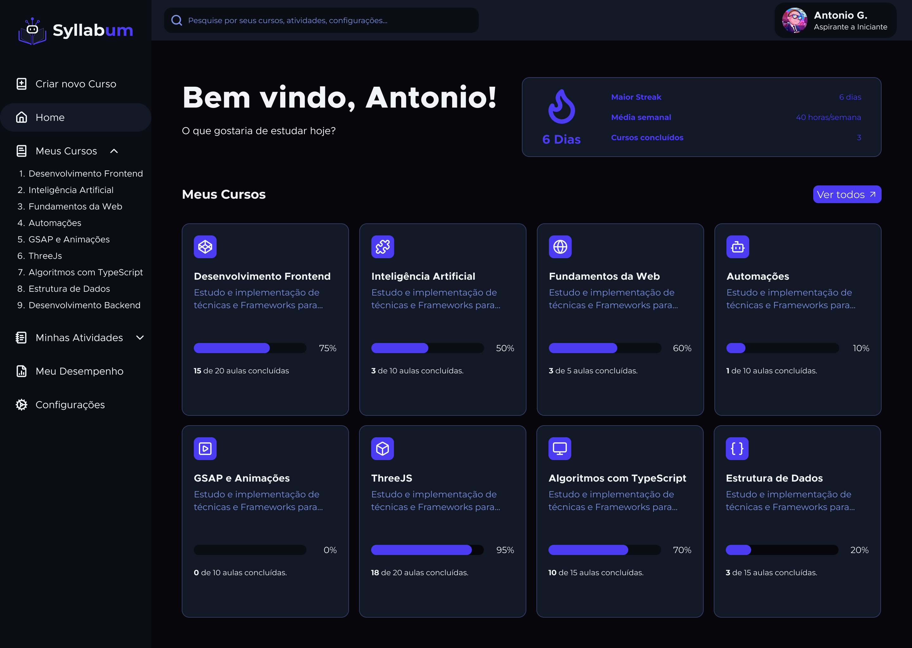
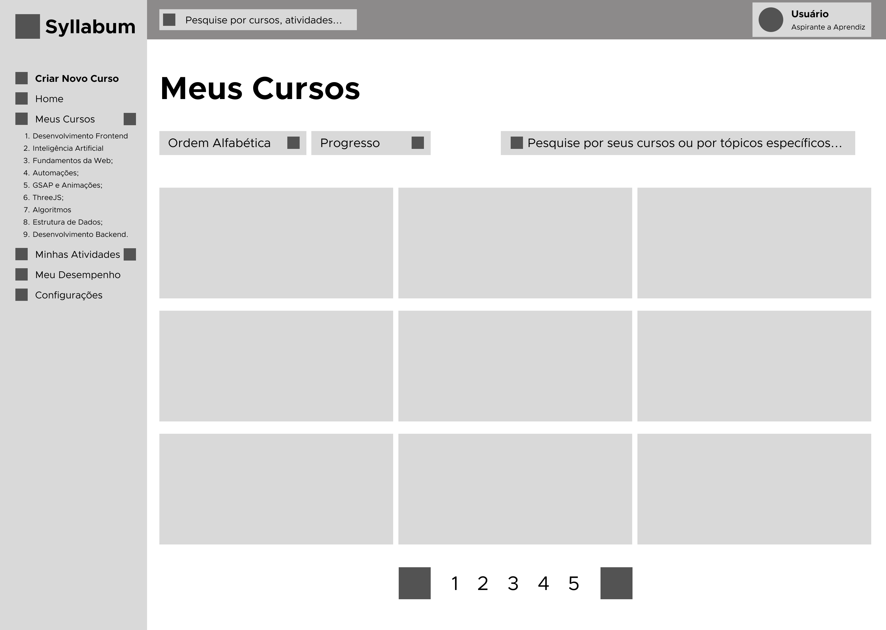
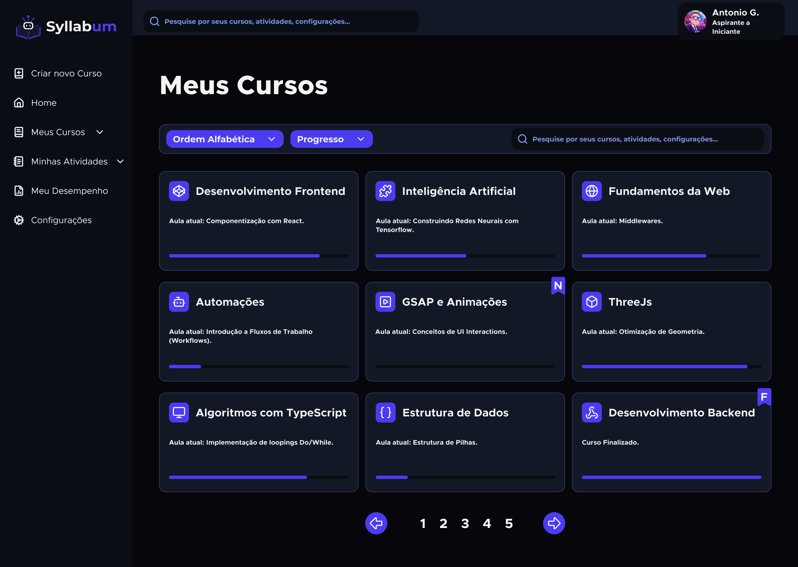

# Protótipo de Telas:

- **Versão**: 0.2
- **Produto**: Syllabum - Tutor Educacional Inteligente
- **Data de Publicação**: 27/10/2026
- **Última Atualização**: 29/10/2026

## 1. Home Screen (Menu Inicial):

- **Observações**: Para esta tela, não há protótipo de baixa fidelidade. Como se trata de uma tela de apoio (navegação), não há história de usuário que descreva essa tela.  

### Protótipo de Alta Fidelidade:

- **Objetivo da Tela**: Saudação da Aplicação, com barra lateral para atalhos e barra de pesquisa na parte superior para pesquisas gerais ainda mais diretas.

- **Estados que a Tela precisa tratar**: Ausência de Cursos e Carregamento de Informações.

---

## 2. Painel de Cursos:

- **Observações**: Como esta tela também se trata de uma tela de apoio (navegação), não há história de usuário propriamente que a descreva.

### Protótipo de Baixa Fidelidade:

### Protótipo de Alta Fidelidade:

- **Objetivo da Tela**: Organizar, em formato de Grid, cursos existentes do estudante. Permite pesquisar e encontrar cursos específicos com mais praticidade e organizar a estrutura do curso de acordo com preferências do próprio usuário (Ordem Alfabética crescente ou decrescente, quantidade de tópicos a estudar, etc.).

- **Estados que a Tela precisa tratar**: Ausência de Cursos e Carregamento de Informações.

---

## 3. Formulário para Criação de Cursos:

### Protótipo de Baixa Fidelidade:

### Protótipo de Alta Fidelidade:

- **Objetivo da Tela**:

- **Estados que a Tela precisa tratar**:

- **Histórias de Usuário, Regras de Negócio e Critérios de Aceitação atendidos**:

---

## 4. Diálogo com o Modo Tutor:

### Protótipo de Baixa Fidelidade:

### Protótipo de Alta Fidelidade:

- **Objetivo da Tela**:

- **Estados que a Tela precisa tratar**:

- **Histórias de Usuário, Regras de Negócio e Critérios de Aceitação atendidos**:

---

## 5. Diálogo com o Modo Debugger:

### Protótipo de Baixa Fidelidade:

### Protótipo de Alta Fidelidade:

- **Objetivo da Tela**:

- **Estados que a Tela precisa tratar**:

- **Histórias de Usuário, Regras de Negócio e Critérios de Aceitação atendidos**:

---

## 6. Painel de Atividades:

### Protótipo de Baixa Fidelidade:

### Protótipo de Alta Fidelidade:

- **Objetivo da Tela**:

- **Estados que a Tela precisa tratar**:

- **Histórias de Usuário, Regras de Negócio e Critérios de Aceitação atendidos**:

---

## 7. Painel de Desempenho:

### Protótipo de Baixa Fidelidade:

### Protótipo de Alta Fidelidade:

- **Objetivo da Tela**:

- **Estados que a Tela precisa tratar**:

- **Histórias de Usuário, Regras de Negócio e Critérios de Aceitação atendidos**:

---

## 8. Configurações:

### Protótipo de Baixa Fidelidade:

### Protótipo de Alta Fidelidade:

- **Objetivo da Tela**:

- **Estados que a Tela precisa tratar**:

- **Histórias de Usuário, Regras de Negócio e Critérios de Aceitação atendidos**:

---

## 9. Formulário de Cadastro para Usuário:

### Protótipo de Baixa Fidelidade:

### Protótipo de Alta Fidelidade:

- **Objetivo da Tela**:

- **Estados que a Tela precisa tratar**:

- **Histórias de Usuário, Regras de Negócio e Critérios de Aceitação atendidos**:

---

## 10. Formulário de Login para Usuário:

### Protótipo de Baixa Fidelidade:

### Protótipo de Alta Fidelidade:

- **Objetivo da Tela**:

- **Estados que a Tela precisa tratar**:

- **Histórias de Usuário, Regras de Negócio e Critérios de Aceitação atendidos**:

